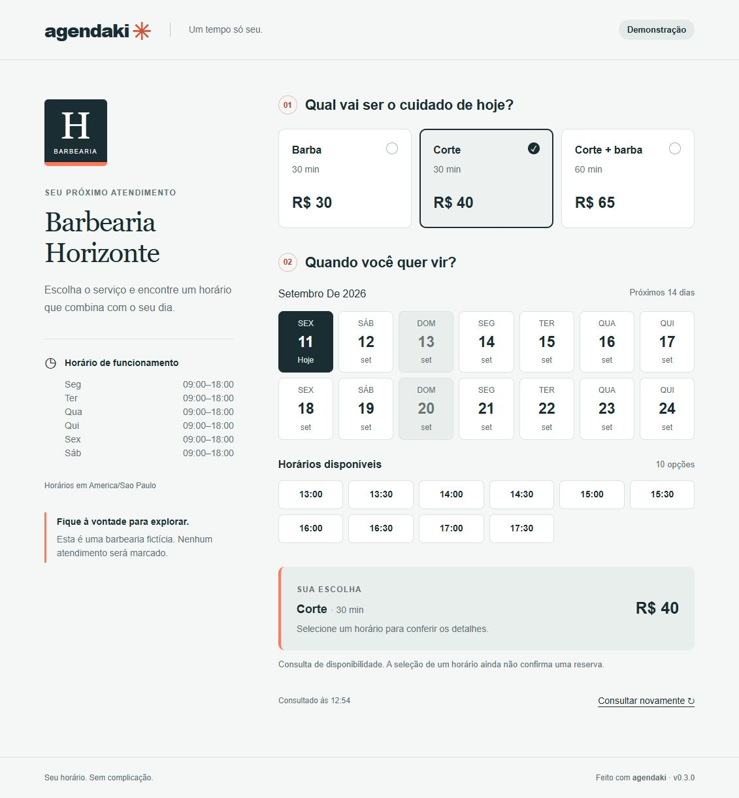

# Agendaki

## [Abrir demonstração online ↗](https://paulo-carvalho10.github.io/agendaki/)

**[Ver também o painel do dono ↗](https://paulo-carvalho10.github.io/agendaki/painel/)**

**[Versão com banco de verdade ↗](https://agendaki-ten.vercel.app/)** — a mesma barbearia fictícia, agora
gravando e cancelando de fato. É renovada todo dia, e nenhuma mensagem é enviada.

Explore os serviços, escolha uma data, selecione um horário e confirme com nome
e WhatsApp. Abre no celular e no computador, sem instalar nada. A barbearia é
fictícia: na demonstração online a reserva é simulada e nada é enviado.

Agendamento online para pequenos negócios, com motor de disponibilidade e
proteção contra conflitos no PostgreSQL.

**Versão 0.7.0 · em desenvolvimento.** O cliente escolhe serviço, profissional
(quando há mais de um), data e horário, confirma com nome e WhatsApp, e recebe
um link pessoal para cancelar. O dono entra no painel para ver a agenda do dia,
de todos ou de um profissional, marcar quem veio ou faltou, enviar lembretes,
agendar quem ligou, bloquear horários e configurar serviços, profissionais,
expediente e dados do negócio.
A demonstração no GitHub Pages, com a página do cliente e o painel do dono, usa os
mesmos componentes React e o mesmo motor de disponibilidade, com dados fictícios
renovados a cada visita e sem servidor. A versão Next.js com PostgreSQL, que
grava e cancela de verdade, pode ser executada localmente.



## Stack

Next.js 15 (App Router), React 19, TypeScript, Tailwind CSS 4, PostgreSQL,
Drizzle ORM, Temporal e Vitest. A infraestrutura planejada é Neon + Vercel.

## Abrir a demonstração local

Esta seção é para desenvolvimento. Para conhecer o projeto, use o botão
[Abrir demonstração online](https://paulo-carvalho10.github.io/agendaki/).

```sh
pnpm install --frozen-lockfile
pnpm dev:demo
```

Abra **http://127.0.0.1:3100/barbearia-demo**. O comando inicia um PostgreSQL
temporário, aplica as migrações e carrega a barbearia fictícia. O terminal
mostra também o endereço do painel do dono, o email e uma senha válida só
para aquela execução (ou a de `DEMO_OWNER_PASSWORD`, se definida). Não precisa de
conta Neon, Docker ou `.env`. Ao encerrar com Ctrl+C, os dados temporários são
removidos. Não use esse comando para dados reais. Testado em Windows x64.
Se a porta 3100 já estiver em uso, defina `PORT` (por exemplo, `PORT=3200`).

Para usar seu próprio PostgreSQL, configure `.env` conforme a seção abaixo e
execute `pnpm dev`. Para compilar: `pnpm build`; para servir a compilação: `pnpm start`.
O TypeScript foi fixado na série 5.9 por compatibilidade com a API usada pelo Next.js 15.

## O que está pronto

- Sete tabelas tipadas no Drizzle, com migrações versionadas.
- Instantes em `timestamptz`, fuso separado e expediente em hora local.
- Restrição no PostgreSQL contra sobreposição de reservas do mesmo profissional.
- Proteção transacional entre reservas e bloqueios, inclusive com concorrência.
- Seed repetível de uma barbearia fictícia com três serviços, dois barbeiros e seis reservas futuras.
- Testes de integração que iniciam PostgreSQL real local, sem Docker ou Neon.
- Motor puro de disponibilidade com testes de encaixes, virada de dia e horário de verão.
- Página pública em `/[slug]`, com seleção de serviços, calendário de 14 dias e resumo.
- Leitura do banco no servidor, sem expor informações de clientes à página pública.
- Estados de carregamento, erro, negócio inexistente e datas sem disponibilidade.
- Gravação da reserva com nome e WhatsApp: o horário é recalculado dentro da
  transação, e quem perde uma disputa recebe o aviso para escolher outro.
- Limite de duas reservas futuras por telefone em cada negócio e campo-isca
  contra robôs, sem captcha.
- Tela de confirmação com a mensagem pronta para o WhatsApp do negócio.
- Cancelamento pelo cliente em `/cancelar/[token]`, até uma hora antes: o horário volta a ficar livre.
- Login do dono em `/entrar`, com sessão em cookie `httpOnly` e bloqueio
  temporário depois de cinco senhas erradas.
- Painel em `/painel`: agenda do dia com navegação entre datas, atendido, falta
  e cancelamento, agendamento manual, bloqueios e lembretes do próximo dia com
  a mensagem pronta para o WhatsApp.
- Configurações em `/painel/configuracoes`: criar, editar e desativar serviços,
  definir o expediente da semana e alterar nome e WhatsApp do negócio.
- Vários profissionais no mesmo negócio: cada um com a própria agenda, escolha
  pelo cliente ou "tanto faz", bloqueio de todos ou de um só, filtro no painel e
  cadastro em Configurações. Com um só profissional, as telas ficam como antes.
- Cadastro de um negócio novo pela linha de comando (`pnpm negocio:criar`).
- Demonstração estática do painel, com as mesmas telas e regras, em memória.

## Rodar os testes

Requisitos: Node.js 22.12 ou superior e pnpm 11. O lockfile fixa as versões.

```sh
pnpm install --frozen-lockfile
pnpm check
pnpm test
```

Para executar somente os testes do motor, use `pnpm test:agenda`.
Para ver a barbearia oferecendo horários no terminal, use `pnpm demo:horarios`.
Esses dois comandos não precisam de PostgreSQL nem de `.env`.

O teste usa `embedded-postgres` somente em desenvolvimento. Ele inicia um banco
temporário em `127.0.0.1`, escolhe uma porta livre, aplica as migrações, testa e
encerra o servidor. Não lê `DATABASE_URL` e não toca no banco remoto.
Os arquivos temporários ficam em `.test-postgres` ou no diretório indicado por
`TEST_WORK_DIR`. O pacote do PostgreSQL e o esbuild precisam executar os scripts
de instalação permitidos no `pnpm-workspace.yaml`.

## Aplicar no Neon ou PostgreSQL de desenvolvimento

1. Copie `.env.example` para `.env`.
2. Preencha `DATABASE_URL` com a conexão do banco de desenvolvimento. No Neon,
   preserve `sslmode=require` na URL fornecida pelo serviço.
3. Execute `pnpm db:migrate`.
4. Para a demonstração, configure `ALLOW_DEMO_SEED=true` e
   `DEMO_OWNER_PASSWORD` com pelo menos 12 caracteres.
5. Execute `pnpm db:seed`.

O usuário de migração precisa poder criar tabelas, funções e a extensão
`btree_gist`. O ambiente deve manter `READ COMMITTED`, padrão do PostgreSQL.
Não há conexão remota configurada nesta entrega.

Nunca prefixe as variáveis do banco ou de autenticação com `NEXT_PUBLIC_`.
`.env` está ignorado pelo Git. O email fictício do dono é
`dono@barbearia.example`; sua senha vem do ambiente e é armazenada como hash
scrypt com salt aleatório. A integração com Auth.js será feita na etapa do login.

## Como ler o código

| Arquivo | Responsabilidade |
|---|---|
| `src/db/schema.ts` | Tabelas, tipos, chaves e validações declarativas |
| `drizzle/0000_inicial.sql` | Criação das seis tabelas, gerada pelo Drizzle |
| `drizzle/0001_protecao_agenda.sql` | Exclusão de intervalos, proteção entre tabelas e validação de fuso |
| `src/db/client.ts` | Conexão no servidor e associação do schema ao Drizzle |
| `src/db/seed.ts` | Dados fictícios e reposição da demonstração em transação |
| `scripts/migrate.ts` | Aplica migrações pendentes e encerra a conexão |
| `scripts/seed.ts` | Valida a configuração de demo e executa o seed |
| `tests/database.test.ts` | Exercita as garantias no PostgreSQL real |
| `src/agenda/horarios-livres.ts` | Calcula disponibilidade com dados recebidos, sem banco/rede/relógio global |
| `tests/horarios-livres.test.ts` | Casos esperados de disponibilidade, fuso e entradas inválidas |
| `scripts/demo-horarios.ts` | Exemplo reproduzível da agenda no terminal |
| `drizzle/0003_varios_profissionais.sql` | Tabela de profissionais, exclusão por profissional e bloqueio de um ou de todos |
| `src/agenda/disponibilidade.ts` | Horários livres por profissional e escolha de quem atende, sem banco |
| `src/agenda/ocupacao.ts` | Leitura de profissionais, expediente, bloqueios e horários ocupados |
| `tests/migracao-profissionais.test.ts` | Aplica a migração 0003 sobre um banco que já tem clientes marcados |
| `src/agenda/pagina-publica.ts` | Consulta pública consistente, incluindo ocupações que atravessam a janela |
| `app/[slug]/page.tsx` | Rota pública renderizada no servidor |
| `app/components/agenda-publica.tsx` | Seleção de serviço, data e horário, formulário e confirmação |
| `src/agenda/pedido-reserva.ts` | Validação do pedido e tipos, sem banco: serve ao servidor e à demo estática |
| `src/agenda/reservar.ts` | Grava a reserva, revalidando o horário e tratando conflitos |
| `src/agenda/cancelar.ts` | Consulta e cancelamento pelo token do cliente |
| `app/acoes.ts` | Server Actions de reservar e cancelar |
| `app/cancelar/[token]/page.tsx` | Página do link de cancelamento |
| `tests/reservas.test.ts` | Reserva, disputa, limite e cancelamento no PostgreSQL real |
| `drizzle/0002_painel_do_dono.sql` | Tabela de sessões, contagem de falhas de login e registro do lembrete |
| `src/auth/sessao.ts` | Conferência de senha, bloqueio por tentativas e sessões |
| `src/painel/agenda.ts` | Leitura da agenda do dia, dos lembretes e dos horários livres para o dono |
| `src/painel/acoes.ts` | Mudança de situação, lembrete, bloqueios e agendamento manual |
| `app/painel/` | Página do painel, Server Actions e conferência da sessão |
| `app/components/painel-agenda.tsx` | Interface do painel, sem dependência do Next.js |
| `tests/painel.test.ts` | Login, sessão, agenda, ações e isolamento entre negócios |
| `src/painel/configuracao.ts` | Leitura e gravação de serviços, profissionais, expediente e dados do negócio |
| `app/painel/configuracoes/page.tsx` | Página de configurações |
| `app/components/painel-configuracoes.tsx` | Interface das configurações |
| `app/components/painel-cabecalho.tsx` | Topo e abas comuns às telas do painel |
| `src/db/negocios.ts` | Cadastro de um negócio com o acesso do dono |
| `scripts/criar-negocio.ts` | Linha de comando do cadastro |
| `tests/configuracao.test.ts` | Cadastro, serviços, profissionais, expediente e isolamento entre negócios |
| `src/painel/demo.ts` | O painel em memória, para a demonstração sem servidor |
| `demo/painel.tsx` | Entrada da demonstração estática do painel |
| `tests/painel-demo.test.ts` | Regras da demonstração do painel |
| `scripts/preview-demo.ts` | Demonstração local com banco temporário |

## Decisões e limites

**Datas.** Reservas e bloqueios são instantes com início e fim. Expediente é uma
regra local por dia da semana, com `termina_dia_seguinte` para horários como
22h–02h. Os intervalos têm início inclusivo e fim exclusivo: 9h–10h permite um
novo atendimento às 10h. A geração de encaixes usa Temporal com o polyfill
`@js-temporal/polyfill`, sem depender do fuso configurado no computador.

## Contrato do motor

`calcularHorariosLivres(entrada)` recebe fuso IANA, data inicial local,
quantidade de dias (1–14), duração do serviço e passo da grade (minutos inteiros
de 1–1440), expediente semanal, bloqueios, agendamentos ocupados e `agoraUTC`.
Devolve intervalos `{ inicio, fim }` em ISO UTC com `Z`, ordenados e sem duplicatas.
Entradas não são modificadas; entradas inválidas geram `RangeError`.

- O passo é ancorado na abertura. Um bloqueio de 9h10–9h40 não cria um novo
  início às 9h40 numa grade de meia em meia hora.
- O serviço precisa caber inteiro no expediente e não pode tocar o interior
  de nenhuma ocupação. Terminar exatamente no começo de um bloqueio é permitido.
- Faixas de funcionamento sobrepostas ou adjacentes são unidas. A grade fica
  ancorada na primeira abertura desse período contínuo.
- A janela filtra a **data local do início**. Uma reserva pode terminar no dia
  seguinte. A consulta inclui a madrugada de um expediente iniciado ontem.
- Horários anteriores a `agoraUTC` são excluídos. Um início igual a agora cabe;
  a antecedência mínima não faz parte deste MVP.
- Duração e passo representam minutos reais. No avanço do horário de verão,
  não aparecem horas inexistentes. No retorno, as duas ocorrências de uma hora
  são instantes UTC diferentes; a futura tela deve distingui-las pelo offset.
- Se a própria abertura ou fechamento for ambígua/inexistente, a função rejeita
  a configuração com erro, em vez de escolher um instante silenciosamente.
- O chamador deve filtrar reservas canceladas e fornecer todas as ocupações
  que **intersectam** os expedientes consultados, incluindo as iniciadas antes
  da janela ou terminadas depois dela. Uma consulta só por data de início perde
  conflitos. O adaptador `obterPaginaPublica` já faz essa consulta por interseção.
- O resultado não garante uma reserva: `reservarHorario` recalcula o horário
  dentro da transação e a proteção transacional do PostgreSQL decide as disputas.

Exemplo: 9h–18h, serviço e passo de 30 minutos, almoço 12h–13h e reservas
10h–10h30 e 15h–16h produzem 13 encaixes. `pnpm demo:horarios` mostra cada um
em horário local e UTC.

Referência da política de conversão: [documentação do Temporal sobre fusos e
ambiguidades](https://github.com/tc39/proposal-temporal/blob/main/docs/timezone.md).

## Garantias do banco e demonstração

**Concorrência.** `UNIQUE(negocio_id, inicio)` não impediria 9h–10h contra
9h30–10h30. Por isso a migração cria uma exclusão GiST sobre o intervalo inteiro.
Reservas canceladas deixam de ocupar a agenda; atendidas e faltas preservam o
histórico ocupado. Antes de alterar uma reserva ou bloqueio, o trigger atualiza
`negocio.agenda_revisao`. Essa escrita ordena operações concorrentes do mesmo
negócio. Depois ele consulta a outra tabela e recusa conflitos. A revisão é
metadado interno, não uma funcionalidade nova.

Uma exclusão entre reservas sozinha não protegeria um bloqueio criado na outra
tabela. Os testes mantêm a primeira transação aberta e verificam no PostgreSQL
que a segunda está aguardando o lock; após o commit, ela deve falhar.

Em `REPEATABLE READ` ou `SERIALIZABLE`, a disputa pode resultar em `40001`.
`reservarHorario` repete a transação completa em falhas de serialização ou
deadlock e traduz `23P01` em "esse horário acabou de ser ocupado". A suíte
exercita o nível padrão `READ COMMITTED`.

**Integridade.** O serviço deve pertencer ao negócio da reserva, por chave
estrangeira composta. Preços são centavos inteiros. Fuso é validado contra o
catálogo do PostgreSQL. Registros de agenda não podem ser transferidos entre
negócios. Editar um serviço não altera a duração de reservas já gravadas.

**Migrações.** Use `pnpm db:generate` para alterações declarativas futuras e
migrações customizadas para triggers/exclusão. Não use `drizzle-kit push`: as
garantias SQL customizadas não estão integralmente representadas no schema TS.
Não edite uma migração já aplicada em um banco compartilhado.

**Demonstração.** `demonstracao=true` identifica o negócio fictício. O seed
recria somente os dados desse negócio, dentro de uma transação; outros negócios
são preservados. Os agendamentos ficam nos próximos três dias de funcionamento,
a partir de amanhã, com almoço bloqueado e três serviços (R$ 40, R$ 30 e R$ 65).
Reexecutar renova os dados, os códigos de cancelamento e a senha da demo.
Telefones são placeholders inválidos e o domínio de email é `.example`.
Quando a interface existir, ações de WhatsApp na demo deverão apenas exibir a
mensagem, sem envio. O seed não faz chamadas externas nem envia mensagens.

O banco guarda SHA-256 de tokens aleatórios de cancelamento com 256 bits de
entropia. O token em si só aparece uma vez, na tela de confirmação, e a página
`/cancelar/[token]` pede ao navegador que não o envie no cabeçalho Referer.
O seed imprime os links relativos dos agendamentos de exemplo.

## Reserva e cancelamento

**Reservar.** `reservarHorario(db, pedido)` valida nome e telefone (DDD
obrigatório, celular ou fixo), confere que o serviço está ativo e pertence ao
negócio, recalcula os horários livres do dia com o mesmo motor da página e só
então grava. Um horário fora da grade, no passado, além dos 14 dias ou já
ocupado é recusado sem gravar nada. O telefone é guardado só com dígitos.

**Limites.** Cada telefone pode manter duas reservas futuras por negócio.
É uma barreira simples contra quem tenta lotar a agenda; não substitui limite
por IP nem verificação do número, que ficam para a publicação.

**Avisar o negócio.** Não há envio automático de mensagens. A tela de
confirmação traz um botão que abre o WhatsApp do negócio com a mensagem pronta.
No negócio de demonstração a mensagem é só exibida.

**Cancelar.** O cliente cancela pelo link até uma hora antes do horário
(`ANTECEDENCIA_CANCELAMENTO_MIN`), para o negócio ainda ter tempo de ocupar a
vaga. Depois disso a página explica que o prazo terminou e oferece avisar o
negócio pelo WhatsApp. Reservas já atendidas ou marcadas como falta não podem
ser canceladas por ele. Para remarcar, cancela e escolhe outro horário.

## Vários profissionais

**Uma agenda por profissional.** Cada agendamento pertence a um profissional, e
a exclusão GiST passou a valer por profissional: dois barbeiros atendem no mesmo
horário, e nenhum deles fica com dois clientes ao mesmo tempo. O bloqueio pode
ser de todos (almoço, feriado) ou de um só (folga, curso). O trigger confere os
dois casos, nas duas direções.

**Escolha do cliente.** Com mais de um profissional ativo, a página pergunta
"Com quem você prefere?". Quem responde "tanto faz" vê todos os horários em que
alguém está livre, e a reserva vai para quem tem menos atendimentos naquele dia
(no empate, quem foi cadastrado primeiro). Quem escolhe um nome só vê e só
disputa a agenda dele. Com um único profissional ativo essa pergunta não
aparece, e a página, a confirmação e o painel ficam como eram.

**Reservas em fila.** `reservarHorario` trava a linha do negócio no início da
transação. As reservas de um mesmo negócio entram uma por vez, então a escolha
de quem atende sempre enxerga a agenda atual. A exclusão e o trigger continuam
no banco para qualquer gravação que não passe por essa função.

**No painel.** A agenda do dia mostra com quem é cada horário e pode ser
filtrada por profissional, com o resumo do dia acompanhando o filtro. O dono
agenda com alguém específico ou com quem estiver livre, e bloqueia a agenda de
todos ou de um. Em Configurações ele adiciona, renomeia e desativa
profissionais. Desativar preserva o histórico, e é recusado para o último que
atende e para quem ainda tem cliente confirmado pela frente.

**Bancos que já existiam.** A migração 0003 cria um profissional chamado
"Profissional" em cada negócio e entrega a ele todos os agendamentos; os
bloqueios antigos continuam valendo para todos. O dono troca o nome em
Configurações.

**Limites desta versão.** Todos os profissionais fazem todos os serviços e
seguem o horário de funcionamento do negócio; a folga de um deles é um
bloqueio. Serviços por profissional, expediente individual e um login para
cada profissional não fazem parte desta etapa.

## Painel do dono

**Login sem biblioteca de autenticação.** O plano original citava Auth.js. Para
um único tipo de acesso (email e senha do dono), sessões próprias ficaram
menores e mais fáceis de testar: o token nasce de `randomBytes(32)`, o banco
guarda só o SHA-256 e o navegador recebe um cookie `httpOnly`, `SameSite=Lax` e
`Secure` em produção, válido por 30 dias. Sair apaga a sessão no banco.
A senha é conferida com scrypt em tempo constante. Email inexistente e senha
errada devolvem a mesma resposta. Depois de cinco erros seguidos, aquele email
fica travado por 15 minutos.

**Um negócio não enxerga o outro.** Toda consulta e toda ação do painel recebe
o `negocioId` da sessão e filtra por ele. Um identificador de outro negócio
recebe a mesma resposta de um identificador que não existe.

**Situações.** Atendido e falta só podem ser marcados depois que o horário
começa, e dá para desfazer. O dono cancela um horário confirmado a qualquer
momento, sem o prazo de uma hora que vale para o cliente. Horário cancelado
não é reativado: faz-se um novo agendamento.

**Lembretes com um toque.** O painel lista os clientes confirmados do próximo
dia que tiver clientes (até quatro dias à frente, o que cobre o domingo fechado)
e abre o WhatsApp de cada um com a mensagem pronta. Não há envio automático.
O horário em que o lembrete foi aberto fica registrado. No negócio de
demonstração a mensagem é só exibida.

**Agendamento manual.** Para quem ligou ou veio ao balcão. Usa a mesma função
da página pública, com as mesmas conferências, sem o limite por telefone e
com telefone opcional.

**Bloqueios.** Fecham um intervalo no fuso do negócio. O banco recusa um
bloqueio que cubra um horário já marcado.

**Serviços.** O dono cria, edita e desativa. Não há exclusão: desativar tira o
serviço da página pública e preserva o histórico. A duração vai de 5 minutos a
8 horas, de 5 em 5. Mudar a duração não altera horários já marcados.

**Expediente.** A tela edita uma faixa por dia, sem virar a noite, e troca o
expediente inteiro numa transação. Expedientes com mais de um turno ou que
passam da meia-noite continuam aceitos pelo motor, mas são configurados fora da
tela, que os mostra só para leitura e não os sobrescreve. Horários já marcados
fora do novo expediente continuam valendo.

**Dados do negócio.** Nome e WhatsApp. O endereço da página (`slug`) não muda
pelo painel, para não quebrar links já divulgados. No negócio de demonstração
nome e WhatsApp ficam fixos.

## Cadastrar um negócio

```sh
pnpm negocio:criar --nome "Barbearia do Zé" --telefone "(34) 99999-0000" --email dono@exemplo.com
```

Cria o negócio e o acesso do dono, com um profissional, expediente de segunda a
sexta, das 9h às 18h, e sem serviços. O endereço da página sai do nome (`barbearia-do-ze`), ou de
`--slug`. Sem `--senha`, uma senha é gerada e mostrada uma única vez: o banco
guarda só o hash. Endereços usados pelo sistema (`painel`, `entrar`, `cancelar`
e outros) são recusados. Depois disso, o dono entra em `/entrar` e completa
serviços, profissionais e horários em Configurações. Opcionais: `--slug`,
`--senha`, `--fuso` e `--profissional` (o nome de quem atende).

## Validação desta etapa

124 testes: 43 do motor, 2 dos dados de demonstração, 7 da validação do
pedido e da exibição de preço, 4 do painel de demonstração e 68 de integração
com PostgreSQL real (20 das garantias do banco e da página pública, 18 de
reserva e cancelamento, 16 do login e do painel, 12 do cadastro e das
configurações, 2 da migração para vários profissionais).
O motor cobre resultados exatos, bloqueios parciais, precisão de microssegundos,
grade, passado, janela de 14 dias, madrugada, faixas unidas, horário de verão,
fuso com offset fracionário, imutabilidade e rejeição de entradas inválidas.
O exemplo de terminal devolve os 13 encaixes esperados.

15 testes de integração cobrem migrações repetidas, sobreposição parcial,
adjacência, cancelamento/reativação, isolamento entre negócios, serviço inválido,
duração/preço, fuso/expediente, UTC, bloqueios, três disputas simultâneas e seed
repetido. O teste de UTC normaliza a representação textual retornada pelo driver
antes de comparar o instante.

Os dois testes adicionais do adaptador público verificam privacidade, isolamento
entre negócios, ocupações anteriores à janela, reservas canceladas, serviços
inativos, negócio vazio e slug inexistente. A limpeza do PostgreSQL temporário
tem repetição limitada para lidar com arquivos que o Windows ainda está liberando.

Os testes de reserva cobrem gravação, privacidade da página pública, dados
inválidos, serviço inativo ou de outro negócio, horários que o motor não
ofereceria, sobreposição parcial, bloqueio, cinco pedidos simultâneos para o
mesmo horário (exatamente um vence), limite por telefone, cancelamento e o
prazo de uma hora para cancelar. Com dois profissionais, cobrem dois clientes
no mesmo horário, a escolha de um profissional, a distribuição de quem não tem
preferência, profissional inativo ou de outro negócio, bloqueio de um só e
cinco pedidos simultâneos (exatamente dois vencem, um com cada).

O indicador de desenvolvimento do Next.js está desativado. Não há cursor
personalizado na página. Em navegadores compatíveis, ferramentas WebMCP permitem
consultar disponibilidade e selecionar um horário; nenhuma delas confirma reservas.

## Próximas etapas do escopo aprovado

1. ~~Gravação de reservas com revalidação da disponibilidade e tratamento de conflitos.~~ Feito na 0.4.0.
2. ~~Cancelamento pelo cliente.~~ Feito na 0.4.0.
3. ~~Login e painel do dono: agenda do dia, atendido ou falta, bloqueios,
   agendamento manual e lembretes com mensagem pronta.~~ Feito na 0.5.0.
4. ~~Edição de serviços, horário de funcionamento e dados do negócio pelo
   painel; cadastro de um negócio novo; demonstração pública do painel.~~
   Feito na 0.6.0.
5. ~~Publicação com banco de produção.~~ No ar na Vercel com Neon desde a 0.6.0 (veja "Publicar na Vercel").
6. ~~Vários profissionais no mesmo negócio.~~ Feito na 0.7.0.

Funcionalidades fora do MVP estão registradas em `V2.md`.

## Publicar na Vercel

A versão que grava de verdade roda na Vercel com PostgreSQL do Neon. O plano
gratuito da Vercel não permite uso comercial: serve enquanto o Agendaki é
demonstração e deve ser trocado antes da primeira venda.

1. Importe o repositório na Vercel. `vercel.json` já define o comando de build,
   a região de São Paulo (`gru1`) e a rotina diária.
2. Adicione o Neon pelo Marketplace da Vercel, de preferência na região de São
   Paulo. A integração cria `DATABASE_URL` (com pool, usada pela aplicação) e
   `DATABASE_URL_UNPOOLED` (direta, usada pelas migrações).
3. Crie duas variáveis de ambiente de produção: `DEMO_OWNER_PASSWORD`, com pelo
   menos 12 caracteres, e `CRON_SECRET`, um valor aleatório longo.
4. Publique. O build roda `scripts/vercel-migrar.ts` antes do `next build`, e
   as migrações só são aplicadas quando `VERCEL_ENV` é `production`.

**Demonstração renovada todo dia.** `/api/reiniciar-demo` recria a barbearia
fictícia: apaga os agendamentos, inclusive o que visitantes digitaram, e põe os
de exemplo nos próximos dias. A Vercel chama esse endereço às 4h de Brasília
com `CRON_SECRET` no cabeçalho; sem o segredo certo ele responde 401. Para
criar a demonstração logo depois da primeira publicação:

```sh
curl -H "Authorization: Bearer $CRON_SECRET" https://SEU-ENDERECO/api/reiniciar-demo
```

**Negócios de verdade** são criados com `pnpm negocio:criar`, apontando
`DATABASE_URL` para o banco de produção. A rotina diária não toca neles.

**pnpm.** O campo `packageManager` fixa o pnpm 11, a mesma versão do
desenvolvimento.

## Hospedagem no GitHub Pages

O Pages publica a pasta `docs/` da branch `main`. Para atualizar a demonstração:

```sh
pnpm build:pages
```

Versione os arquivos gerados de `docs/` junto com a alteração. A entrada
`demo/main.tsx` reutiliza `AgendaPublica`; `src/agenda/dados-demo.ts`
gera uma janela móvel de 14 dias com o motor real, sem consultar um banco.
A entrada `demo/painel.tsx` reutiliza `PainelAgenda` e publica o painel do dono
em `/agendaki/painel/`, com o estado guardado na memória da página.
Os caminhos dos assets funcionam no prefixo `/agendaki/`, incluindo
`/agendaki/barbearia-demo/`. Nenhuma credencial ou dado pessoal é publicado.
