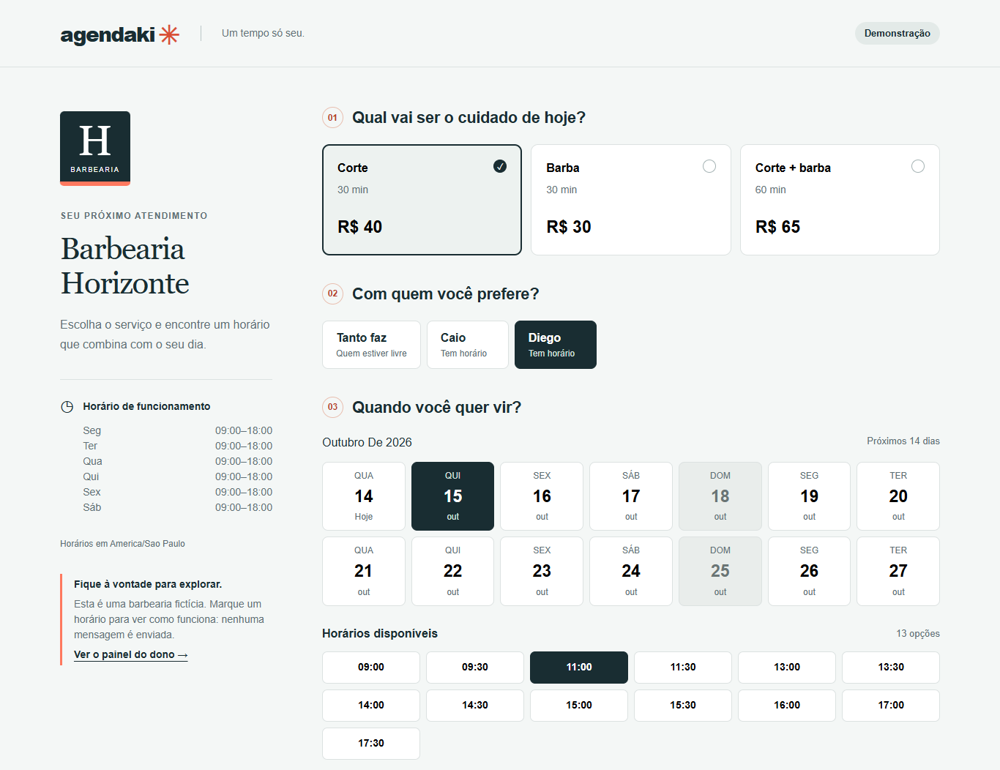
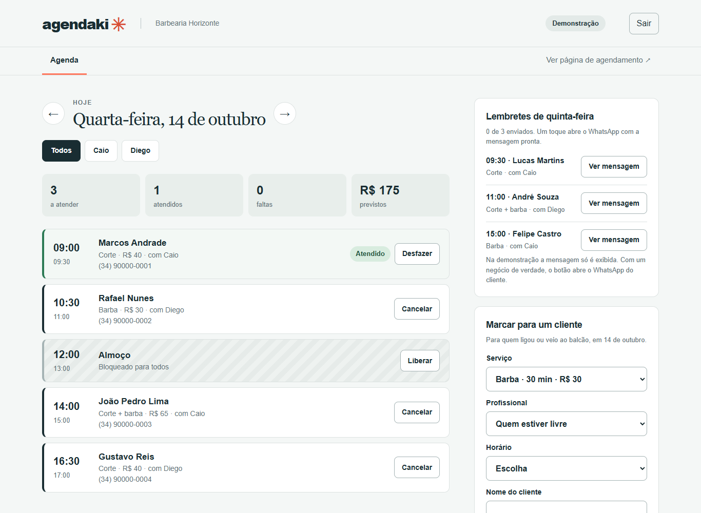
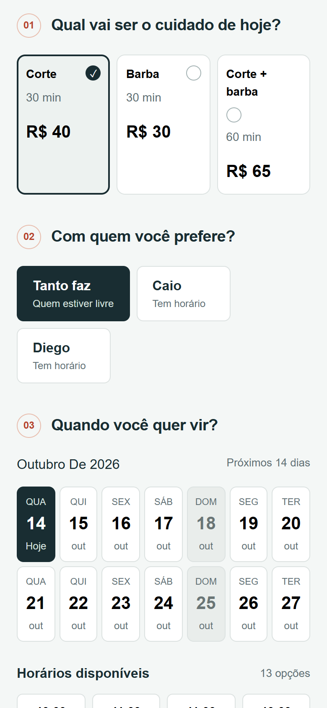
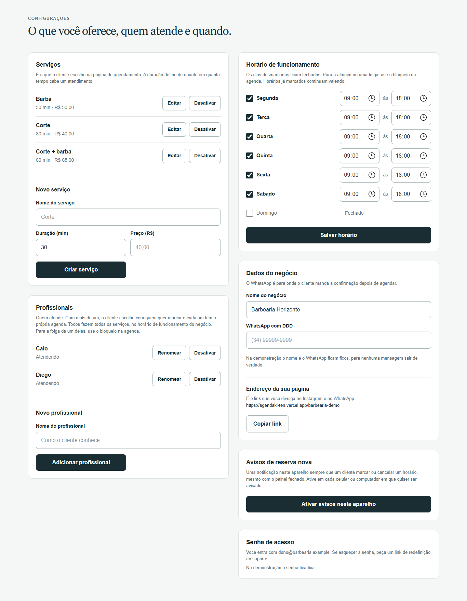

<div align="center">

# agendaki✳

**Agendamento online para barbearias, salões e pequenos negócios de serviço.**
O cliente marca sozinho pelo celular; o dono acompanha tudo num painel e é avisado na hora.

[**Experimentar a página do cliente**](https://paulo-carvalho10.github.io/agendaki/) ·
[**Ver o painel do dono**](https://paulo-carvalho10.github.io/agendaki/painel/) ·
[**Versão com banco de dados**](https://agendaki-ten.vercel.app/barbearia-demo)


</div>



> As demonstrações usam uma barbearia fictícia. Nas duas primeiras nada é gravado;
> na versão com banco, as reservas são de verdade e tudo volta ao início todo dia.
> Nenhuma mensagem é enviada a ninguém.

## O que ele resolve

Quem atende sozinho ou com poucas pessoas perde tempo respondendo "tem horário
amanhã?" no WhatsApp, esquece de confirmar, e descobre o buraco na agenda quando
o cliente não aparece. O Agendaki dá ao negócio uma página própria de
agendamento, que mostra só os horários realmente livres, e um painel simples
para o dia a dia.

## Para o cliente

- Escolhe o serviço, **com quem quer ser atendido** (ou "tanto faz"), o dia e o horário, em poucos toques.
- Vê só horários que cabem de verdade: respeita o expediente, o almoço, as folgas e quem já está marcado.
- Confirma com nome e WhatsApp, sem criar conta nem baixar aplicativo.
- Recebe um link pessoal para **cancelar até 1 hora antes**; a vaga volta a ficar livre na hora.
- Avisa o negócio com um toque: o WhatsApp abre com a mensagem pronta.

## Para o dono

- **Agenda do dia**, de todos ou de um profissional, com o resumo do previsto e do realizado.
- Marca quem foi atendido ou faltou, cancela, agenda quem ligou ou veio ao balcão e bloqueia horários (de todos ou de um só).
- **Aviso no celular** quando um cliente marca ou cancela, mesmo com o painel fechado, e um quadro de novidades desde a última conferida.
- **Lembretes com um toque** para os clientes do dia seguinte, com a mensagem pronta no WhatsApp.
- Configura serviços, preços, durações, profissionais, horário de funcionamento e dados do negócio.
- Troca a própria senha e, se esquecer, recebe um link para criar outra.

<table>
  <tr>
    <td width="68%"></td>
    <td width="32%"></td>
  </tr>
  <tr>
    <td align="center"><sub>Painel do dono</sub></td>
    <td align="center"><sub>Página do cliente no celular</sub></td>
  </tr>
</table>

<details>
<summary><b>Ver a tela de configurações</b></summary>



</details>

## Destaques técnicos

- **Nunca dois clientes no mesmo horário.** A garantia está no PostgreSQL, não só
  na tela: uma restrição de exclusão (GiST) sobre o intervalo de cada profissional
  e um trigger que cruza reservas e bloqueios. Testes abrem duas transações ao
  mesmo tempo e confirmam que só uma vence.
- **Motor de disponibilidade puro e testado.** Calcula os encaixes a partir do
  expediente, dos bloqueios e das reservas, sem banco nem relógio global, com
  Temporal: fusos, expedientes que viram a noite e horário de verão incluídos.
  O mesmo código roda no servidor e nas demonstrações estáticas.
- **Privacidade por padrão.** A página pública nunca recebe nome ou telefone de
  outros clientes. Tokens de cancelamento, sessões e links de senha são
  aleatórios de 256 bits, e o banco guarda só o SHA-256 deles.
- **Autenticação própria e enxuta.** Senhas com scrypt, sessão em cookie
  `httpOnly`, bloqueio depois de cinco erros e respostas iguais para email
  inexistente e senha errada. Cada consulta do painel é filtrada pelo negócio da
  sessão.
- **Avisos em tempo real sem custo de mensagem.** Web Push com chaves VAPID,
  enviado depois da resposta ao cliente, só para os serviços de notificação dos
  navegadores.
- **Migrações seguras para quem já usa.** Cada mudança de estrutura tem um teste
  que a aplica sobre um banco com clientes marcados.

Detalhes, decisões e limites estão em [ARQUITETURA.md](ARQUITETURA.md).

## Tecnologias

| Camada | Escolha |
|---|---|
| Aplicação | Next.js 15 (App Router, Server Actions), React 19, TypeScript |
| Interface | CSS próprio sobre Tailwind CSS 4, pensado primeiro para o celular |
| Dados | PostgreSQL (Neon em produção), Drizzle ORM, migrações SQL versionadas |
| Datas | Temporal (`@js-temporal/polyfill`) |
| Avisos e email | Web Push (`web-push`), SMTP (`nodemailer`) |
| Testes | Vitest com PostgreSQL real embutido, sem Docker |
| Hospedagem | Vercel (região São Paulo) e GitHub Pages para as demonstrações |

## Qualidade

**137 testes automatizados**, 81 deles contra um PostgreSQL real que sobe e
desce sozinho durante a execução:

- 43 do motor de disponibilidade (encaixes, fusos, madrugada, horário de verão, entradas inválidas);
- garantias do banco e disputas simultâneas por um mesmo horário;
- reserva, limite por telefone, cancelamento e prazo de 1 hora;
- login, sessões, painel e isolamento entre negócios;
- vários profissionais, configurações, senha, novidades e avisos;
- migrações aplicadas sobre bancos que já têm clientes.

As telas são conferidas no navegador, no computador e em tamanho de celular, a
cada etapa.

## Rodar localmente

Requisitos: Node.js 22.12 ou superior e pnpm 11.

```sh
pnpm install --frozen-lockfile
pnpm dev:demo
```

O comando sobe um PostgreSQL temporário, aplica as migrações, carrega a
barbearia de demonstração e abre o sistema em http://127.0.0.1:3100. O terminal
mostra o endereço do painel, o email e uma senha válida só para aquela execução.
Não precisa de conta, Docker nem `.env`, e os dados somem ao encerrar com Ctrl+C.
Use `PORT=3200` se a porta 3100 estiver ocupada.

| Comando | O que faz |
|---|---|
| `pnpm test` | Todos os testes, inclusive os de banco |
| `pnpm test:agenda` | Só o motor de disponibilidade, sem banco |
| `pnpm check` | Verificação de tipos |
| `pnpm build` | Compilação de produção |
| `pnpm build:pages` | Gera as demonstrações estáticas em `docs/` |
| `pnpm db:migrate` | Aplica as migrações no banco de `DATABASE_URL` |

## Configuração

Copie `.env.example` para `.env`. Só `DATABASE_URL` é obrigatória; o resto liga
recursos opcionais.

| Variável | Para quê |
|---|---|
| `DATABASE_URL` | Conexão do PostgreSQL usada pela aplicação |
| `DATABASE_URL_UNPOOLED` | Conexão direta para as migrações (criada pela integração do Neon) |
| `DEMO_OWNER_PASSWORD`, `CRON_SECRET` | Senha do dono da demonstração e segredo da renovação diária |
| `VAPID_PUBLIC_KEY`, `VAPID_PRIVATE_KEY`, `VAPID_SUBJECT` | Avisos no celular. Gere o par com `pnpm avisos:chaves` |
| `SMTP_HOST`, `SMTP_PORT`, `SMTP_USER`, `SMTP_PASS`, `EMAIL_REMETENTE` | "Esqueci minha senha" por email, com qualquer provedor SMTP |
| `SITE_URL` | Endereço público usado nos links enviados por email |
| `SUPORTE_WHATSAPP` | Botão de suporte na tela de entrada |

Sem as chaves de aviso, o sistema funciona igual, só sem notificação. Sem SMTP,
a tela "Esqueci minha senha" orienta o dono a pedir o link ao suporte.

## Publicação

A versão com banco roda na Vercel com PostgreSQL do Neon:

1. Importe o repositório na Vercel. `vercel.json` já define o build, a região de São Paulo e a rotina diária.
2. Adicione o Neon pelo Marketplace da Vercel; ele cria as variáveis do banco.
3. Cadastre as demais variáveis de produção da tabela acima.
4. Publique. As migrações rodam antes do build, só no ambiente de produção.

A rotina diária (`/api/reiniciar-demo`, protegida por `CRON_SECRET`) renova a
barbearia de demonstração e não toca em nenhum outro negócio.

> O plano gratuito da Vercel não permite uso comercial. Ele serve para a
> demonstração e deve ser trocado antes do primeiro cliente pagante.

## Operação

```sh
# Cadastrar um negócio (gera a senha do dono, mostrada uma única vez)
pnpm negocio:criar --nome "Barbearia do Zé" --telefone "(34) 99999-0000" --email dono@exemplo.com

# Gerar um link de redefinição de senha para um dono (vale 1 hora, uma vez)
pnpm negocio:link-senha --email dono@exemplo.com --site https://SEU-ENDERECO
```

Os dois comandos usam o banco de `DATABASE_URL`. O negócio começa com um
profissional e expediente de segunda a sexta, das 9h às 18h; o dono completa o
resto em Configurações.

## Estrutura

```
app/            Páginas, Server Actions e componentes de tela
src/agenda/     Motor de disponibilidade, reserva e cancelamento
src/painel/     Agenda do dono, ações, configurações e novidades
src/auth/       Sessões, senha e envio de email
src/avisos/     Inscrições e envio dos avisos no celular
src/db/         Schema, conexão, cadastro de negócio e dados de demonstração
drizzle/        Migrações SQL versionadas
tests/          Testes unitários e de integração com PostgreSQL real
demo/, docs/    Demonstrações estáticas publicadas no GitHub Pages
scripts/        Linha de comando: demonstração local, migrações, cadastro, senha
```

## Limites conhecidos e próximos passos

- Todos os profissionais fazem todos os serviços e seguem o horário do negócio.
- O lembrete ao cliente é enviado pelo dono com um toque, não automaticamente.
- Os avisos ao dono são notificações do navegador; no iPhone exigem o Agendaki na tela de início.
- Ainda não há aviso de privacidade na página do cliente nem bloqueio que se repete (como o almoço de todo dia).

Ideias para depois: serviços e horários por profissional, remarcação direta,
regras de antecedência, lista de clientes, sinal na reserva e relatório do mês.
Algumas estão registradas em [V2.md](V2.md).

## Autor

Desenvolvido por **Paulo Carvalho**.

O código está público para consulta. Não há licença de uso aberta: todos os
direitos são reservados ao autor.
